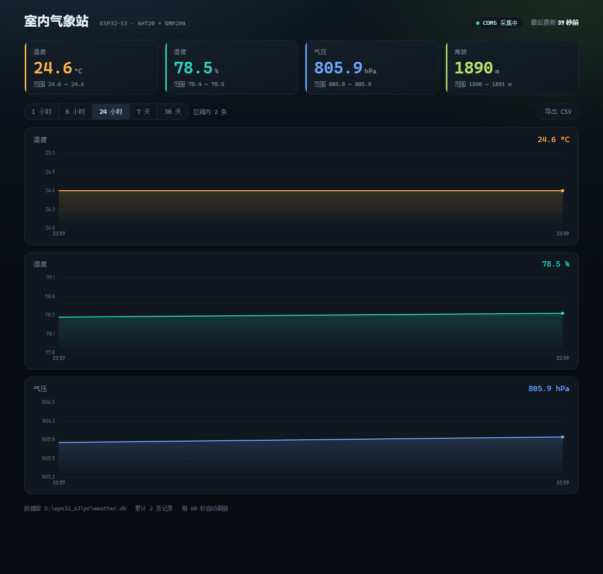
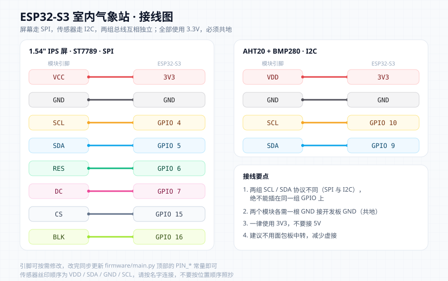

# ESP32-S3 室内气象站

用 ESP32-S3 + 1.54" IPS 屏 + AHT20/BMP280 做一个桌面气象站：板子自带屏幕实时显示温湿度、气压、海拔，同时把数据通过 USB 串口送到电脑，由本地网页持久化记录并画出历史曲线。

不依赖云服务，不需要联网，数据全部留在自己电脑上。



## 功能

- **板载显示**：1.54 寸 240×240 IPS 屏显示温度、湿度、气压、海拔和运行计数
- **自动采集**：上电即运行，默认每 10 分钟采一次，无需人工干预
- **本地网页**：Flask + SQLite，深色看板，1 小时 / 6 小时 / 24 小时 / 7 天 / 30 天切换，鼠标悬停查看任意时刻数值
- **CSV 导出**：一键下载区间数据（带 UTF-8 BOM，Excel 直接打开不乱码）
- **断线自愈**：串口拔插、开发板复位、串口号变化都能自动重连
- **零外部依赖**：曲线用原生 canvas 手绘，页面断网也能正常显示

## 硬件清单

| 部件 | 型号 | 说明 |
| --- | --- | --- |
| 主控 | ESP32-S3 (N16R8) | 16 MB Flash + 8 MB PSRAM |
| 显示屏 | 1.54" IPS 240×240 | ST7789，SPI 接口，8 pin |
| 传感器 | AHT20 + BMP280 二合一 | I2C 接口，温度 / 湿度 / 气压 |
| 其他 | 面包板、杜邦线 | 用于连接 |

## 接线



**显示屏（ST7789，SPI）**

| 屏幕引脚 | ESP32-S3 | 说明 |
| --- | --- | --- |
| VCC | `3V3` | 3.3V 供电 |
| GND | `GND` | 公共地 |
| SCL | `GPIO 4` | SPI 时钟 |
| SDA | `GPIO 5` | SPI 数据 (MOSI) |
| RES | `GPIO 6` | 复位 |
| DC | `GPIO 7` | 命令 / 数据选择 |
| CS | `GPIO 15` | 片选 |
| BLK | `GPIO 16` | 背光（由程序控制） |

**传感器（AHT20 + BMP280，I2C）**

| 模块丝印 | ESP32-S3 | 说明 |
| --- | --- | --- |
| VDD | `3V3` | 3.3V 供电 |
| GND | `GND` | 公共地 |
| SCL | `GPIO 10` | I2C 时钟 |
| SDA | `GPIO 9` | I2C 数据 |

注意事项：

- 所有设备必须**共地**，两个模块各自都要有一根线接到开发板 `GND`。
- 全部使用 `3V3`，不要接 5V。屏幕的 `SCL/SDA`（SPI）和传感器的 `SCL/SDA`（I2C）**协议不同，不能共用同一组 GPIO**。
- 建议面包板只用来固定开发板，不要当中转站——接触点越少，越不容易出现 `ENODEV` 这类偶发通信失败。
- 引脚分配可以自行更改，改完同步修改 `firmware/main.py` 顶部的常量即可。

## 目录结构

```
esp32_s3_weather/
├── firmware/
│   ├── main.py            # 采集端：屏幕显示 + 串口上报（存到开发板为 main.py）
│   └── display_only.py    # 仅屏幕显示、不输出数据的精简版
├── pc/
│   ├── app.py             # 一键启动：串口采集线程 + 网页服务
│   ├── collector.py       # 串口读取 → SQLite，含断线重连
│   ├── webui.py           # Flask 路由与 JSON 接口
│   ├── requirements.txt
│   └── templates/
│       └── index.html     # 看板页面（自绘曲线）
├── tools/
│   └── read_serial.py     # 排错用：直接读取串口原始输出
├── docs/images/           # README 用图
├── start_monitor.bat      # Windows 一键启动（有窗口，便于看日志）
└── start_monitor_silent.vbs  # 静默启动，适合放进开机启动项
```

## 快速开始

### 1. 烧录 MicroPython 固件

用 [esptool](https://github.com/espressif/esptool) 或 Thonny 的「安装或更新 MicroPython」功能刷入 ESP32-S3 固件。

> 六线/八线 PSRAM 版本的固件与部分开发板不匹配时，启动日志会出现
> `PSRAM ... initialization failed`。本项目不使用 PSRAM，可以忽略。

### 2. 部署采集程序

用 Thonny 打开 `firmware/main.py`，菜单 `文件 → 另存为`，目标选择 **MicroPython device**，文件名填 `main.py`。

之后开发板上电就会自动运行，屏幕开始显示数据，同时每 10 分钟通过串口输出一行：

```
DATA,24.52,78.74,805.9,1890
```

### 3. 启动电脑端

```bash
pip install -r pc/requirements.txt
cd pc
python app.py
```

Windows 下也可以直接双击根目录的 `start_monitor.bat`。

启动后：

```
网页已启动：http://localhost:8000
数据库文件：.../pc/weather.db
```

浏览器打开 <http://localhost:8000> 即可看到看板。

> **串口是独占资源**：采集程序运行时，Thonny 无法同时连接开发板（反之亦然）。
> 需要改板子代码时，先关掉采集窗口。

## 命令行参数

```bash
python app.py                  # 自动识别开发板串口（推荐）
python app.py --port COM5      # 手动指定串口
python app.py --simulate       # 无硬件，生成模拟数据预览页面
python app.py --web-port 9000  # 更换网页端口
python app.py --host 0.0.0.0   # 允许同网段设备访问
python app.py --no-reset-on-open  # 打开串口时不复位开发板
```

默认情况下，采集程序打开串口后会主动复位一次开发板，让板子立刻上报一个数据点——这样启动后几秒内页面上就有数字，不用干等一个采样周期。

## 数据与接口

数据保存在 `pc/weather.db`（SQLite），表结构：

```sql
CREATE TABLE readings (
    id    INTEGER PRIMARY KEY AUTOINCREMENT,
    epoch REAL NOT NULL,   -- Unix 时间戳（由电脑侧打点）
    ts    TEXT NOT NULL,   -- 本地时间字符串
    t     REAL,            -- 温度 °C
    h     REAL,            -- 湿度 %RH
    p     REAL,            -- 气压 hPa
    alt   REAL             -- 海拔 m（由气压推算）
);
```

| 接口 | 说明 |
| --- | --- |
| `GET /` | 看板页面 |
| `GET /api/status` | 串口连接状态、累计记录数、最新时间 |
| `GET /api/data?hours=24` | 指定时间范围的采样点（超过 1500 点自动抽稀） |
| `GET /api/export.csv?hours=720` | 导出 CSV |

**时间戳由电脑侧生成**，开发板不带 RTC，只负责上报数值。因此电脑关机期间的采样不会被补录。

## 常用调整

`firmware/main.py` 顶部：

| 参数 | 默认值 | 说明 |
| --- | --- | --- |
| `LOG_SEC` | `600` | 采样间隔（秒），600 = 10 分钟 |
| `SEA_LEVEL` | `1013.25` | 海拔换算的海平面气压基准（hPa） |
| `PIN_*` | — | 各引脚编号 |

关于海拔：程序使用国际标准大气公式

$$h = 44330\left[1-\left(\frac{p}{1013.25}\right)^{0.1903}\right]$$

其中 \(p\) 为当前气压（hPa）。默认基准是标准海平面气压，因此绝对海拔会有几十到一百多米的偏差，天气变化时还会漂移；**相对变化很可靠，绝对数值仅供参考**。想更准就把 `SEA_LEVEL` 改成当地气象台公布的海平面气压。

## 传感器精度与寿命

| 量 | 典型精度 |
| --- | --- |
| 温度（AHT20） | ±0.3 °C |
| 湿度（AHT20） | ±2 %RH |
| 气压（BMP280，相对） | ±0.12 hPa（约 ±1 m 高度差） |
| 气压（BMP280，绝对） | ±1 hPa |

室内桌面环境、定期吹灰的前提下，这套组合可以稳定使用 3 年以上，湿度读数的年漂移在零点几个 %RH 量级。避免阳光直射、远离油烟与加湿器白雾，能进一步延长寿命；读数明显跑偏时可以按厂商建议在 80~85 °C 回烘数小时恢复。

## 排错

| 现象 | 原因与解决办法 |
| --- | --- |
| 网页提示「串口被占用（关掉 Thonny）」 | 串口是独占资源，关闭 Thonny 或先停止采集 |
| `没有找到串口设备` | USB 线没插好，或使用了只能供电的劣质线 |
| 串口连上了但没有数据 | 板子上运行的不是采集程序，按「快速开始」第 2 步重新部署 `main.py` |
| 屏幕全黑但程序在跑 | 检查 `BLK`（背光）与 `VCC` |
| 屏幕花屏 / 雪花 | 降低 `firmware/main.py` 里的 SPI 频率，或缩短接线 |
| `OSError: [Errno 19] ENODEV` | I2C 从机无应答，多为杜邦线虚接：断电重启、重插四根线、避开面包板中转 |
| 板子启动日志出现 PSRAM 初始化失败 | 固件与开发板型号不匹配，本项目不使用 PSRAM，可忽略 |
| 页面显示「暂无数据」 | 数据库还没有记录，等一个采样周期 |

排错工具：

```bash
python tools/read_serial.py COM5 10          # 直接读 10 秒串口原始输出
python tools/read_serial.py COM5 12 --reset  # 先复位开发板再读
```

## 已知限制

- 采集依赖电脑端程序运行，电脑关机 / 休眠期间的数据不会补录
- 开发板无 RTC，时间戳由电脑生成
- 页面为单机版，未做鉴权和 HTTPS，仅适合本机或可信局域网使用

## License

[MIT](LICENSE)
